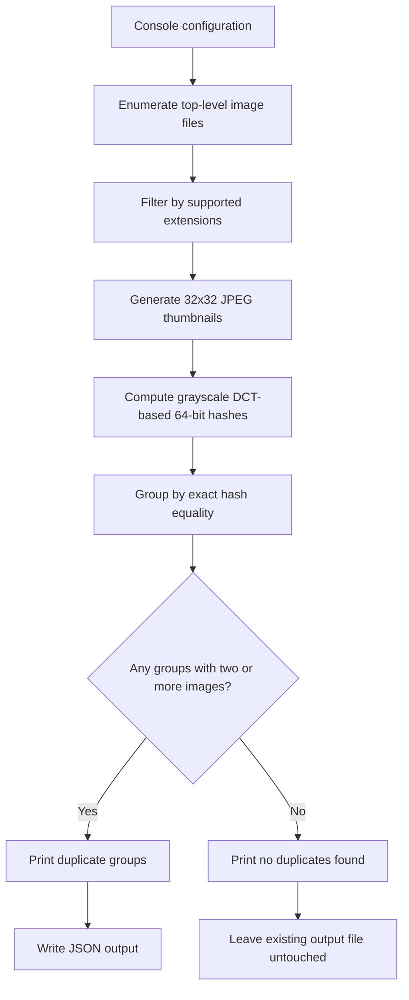
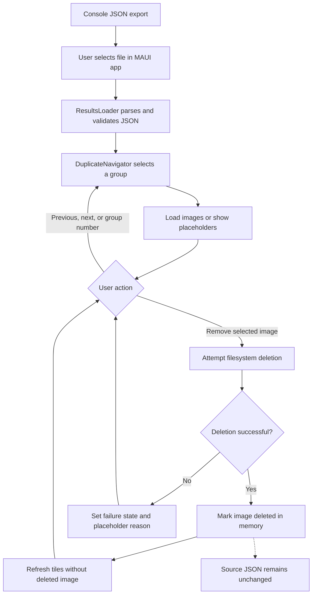

# Image Duplicate Searcher

## Description

Image Duplicate Searcher is a .NET 10 solution with two applications: a console scanner that exports duplicate-image candidates, and a MAUI application that lets you review those candidates and remove selected files.

The scanner groups images with identical 64-bit perceptual hashes. Hash equality is not proof of identical content, and visually similar images may have different hashes. Review candidates before deleting files.

## Projects

| Project Overview | Responsibility |
| --- | --- |
| [src/ImageDuplicateSearcher.Application/overview.md](src/ImageDuplicateSearcher.Application/overview.md) | Shared hashing, reporting, result loading, navigation, display, and removal services |
| [src/ImageDuplicateSearcher.Console/overview.md](src/ImageDuplicateSearcher.Console/overview.md) | Configured directory scan, terminal output, and JSON export |
| [src/ImageDuplicationSearcher.Desktop/overview.md](src/ImageDuplicationSearcher.Desktop/overview.md) | MAUI results review and selected-file removal on Windows and Android |

## Features

- **Perceptual Hashing**: Groups images by exact perceptual-hash equality, without a configurable similarity threshold.
- **Supported Formats**: JPEG, JPG, PNG, and BMP by default.
- **Directory Scanning**: Processes matching files directly inside the configured directory, not subdirectories.
- **Console Output**: Displays duplicate groups with file paths and sizes.
- **JSON Export**: Saves groups containing at least two images to a configurable output file.
- **Results Review**: Opens exported JSON, previews images, and supports previous/next and group-number navigation.
- **File Removal**: Removes selected images and hides them for the current session without modifying the results JSON.
- **Configuration**: Supports a scan directory, output path, and allowed file extensions. Thumbnail dimensions are fixed at 32x32 pixels.

## Requirements

- .NET 10 SDK for building and running from source.
- Console can be built independently without MAUI workloads.
- Windows MAUI review app: Windows 10 version 1809 (build 17763) or later, a Windows development host, and matching .NET MAUI/Windows build tooling.
- Android MAUI review app: Android API 21 or later, matching .NET MAUI/Android tooling, and a device or emulator. Access to referenced image files depends on Android storage permissions.

## Installation

1. Install the .NET 10 SDK and, for the review app, the required platform workloads and toolchains.
2. Clone or download this repository.
3. Create an image directory or configure an existing one. The application does not create the input directory or the output parent directory.

## Usage

### Scan Images

Open [src/ImageDuplicateSearcher.Console/appsettings.json](src/ImageDuplicateSearcher.Console/appsettings.json) and configure the scanner:

```json
{
  "ImageDuplicationOptions": {
    "ImageDirectory": "./images",
    "OutputFilePath": "duplicates.json",
    "SupportedFormats": [".jpeg", ".jpg", ".png", ".bmp"]
  }
}
```

From the repository root:

```powershell
cd src/ImageDuplicateSearcher.Console
dotnet run
```

Run from the Console project directory because settings are loaded from the process working directory. With the example configuration, create an `images` directory there first. Input and output paths are also relative to that working directory; absolute image paths are recommended when opening results from another application.

The scanner prints progress and duplicate groups. If duplicates exist, it writes the configured JSON output. If none exist, it reports that fact but does not create or clear the output file, so an older export may remain.

### Review Results

On Windows, from the repository root:

```powershell
cd src/ImageDuplicationSearcher.Desktop
dotnet run -f net10.0-windows10.0.19041.0
```

1. Select **Open JSON Results** and choose the scanner's exported JSON file.
2. Use **Previous**, **Next**, or enter a one-based group number and submit it.
3. Inspect the images before selecting **Remove** on an unwanted file.

The MAUI app reviews existing results; it does not start scans. Referenced image paths must be accessible on the device running it. Moving a report to Android does not make Windows image paths accessible.

**Deletion warning:** Normal Windows removal sends files to the Recycle Bin; Android removal and platform fallback deletion are permanent. There is no confirmation or undo UI. Only open trusted result files, since their paths identify files that can be deleted. Deletion changes the filesystem and in-memory state, not the exported JSON.

## How It Works

### Scan and Export



### Review and Remove

The applications communicate only through a manually selected JSON file. Both use services from the Application library; there is no live API or automatic synchronization.



## Configuration Options

Scanner options are under the `ImageDuplicationOptions` section:

| Key | Default Configuration | Meaning |
| --- | --- | --- |
| ImageDirectory | ./images | Existing directory to scan, nonrecursive |
| OutputFilePath | duplicates.json | JSON destination; parent directory must exist |
| SupportedFormats | .jpeg, .jpg, .png, .bmp | Allowed lowercase extensions, including the leading dot |

There is no `ThumbnailSize` option; the implementation uses fixed 32x32 thumbnails.

The Console app adds its settings file and then user secrets after Generic Host's default providers. These later sources override matching default environment-variable and command-line values. Restart the scanner to apply changes to its options. The MAUI review app does not load this configuration file.

## Output

- **Console**: Displays the number of images found, progress bar during processing, and lists of duplicate groups with file paths and sizes.
- **JSON Export**: Contains an array of duplicate groups. Each group has an unsigned 64-bit numeric hash and image entries with a path and size. The `sizeMB` field actually stores MiB (bytes divided by 1024 twice).
- **MAUI Review App**: Displays image groups and placeholders for missing, unreadable, or inaccessible files. Removing an image does not remove its entry from the export; reopening the report can show it as missing.

Example JSON output:

```json
[
  {
    "hash": 123456789,
    "images": [
      {
        "path": "path/to/image1.jpg",
        "sizeMB": 2.5
      },
      {
        "path": "path/to/image2.jpg",
        "sizeMB": 2.5
      }
    ]
  }
]
```

Example paths are illustrative. Relative paths resolve against the review app's working directory, not automatically against the JSON file's directory. The loader rejects an empty results array.

## Troubleshooting

- Run the scanner from its project directory and ensure the configured input directory exists.
- Check that the .NET 10 SDK and required MAUI platform workloads are installed.
- Verify configured extensions are lowercase with a leading dot. Files in subdirectories are not scanned.
- Ensure the output parent directory exists and is writable. An unreadable image or a write failure can abort a scan.
- If a no-duplicates scan leaves an old report, remove or archive that report before treating it as current.
- If previews are missing, check the exported paths and device permissions. Prefer absolute paths on the same machine; copying JSON does not copy images.
- If removal fails, check permissions and whether another application has locked the image. Back up files before deleting candidates.

## License

This project is licensed under the MIT License.